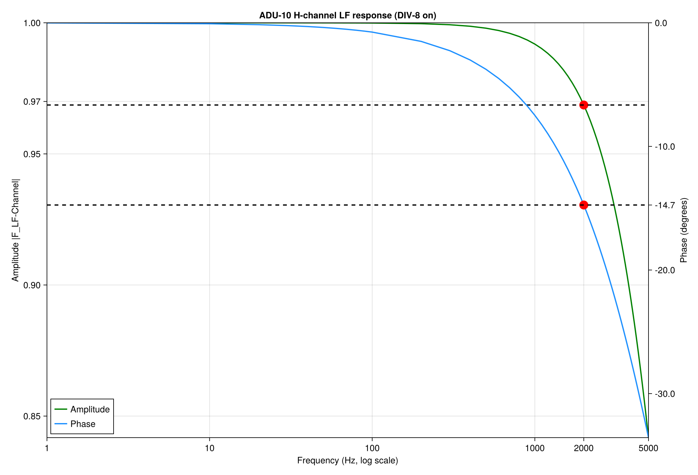
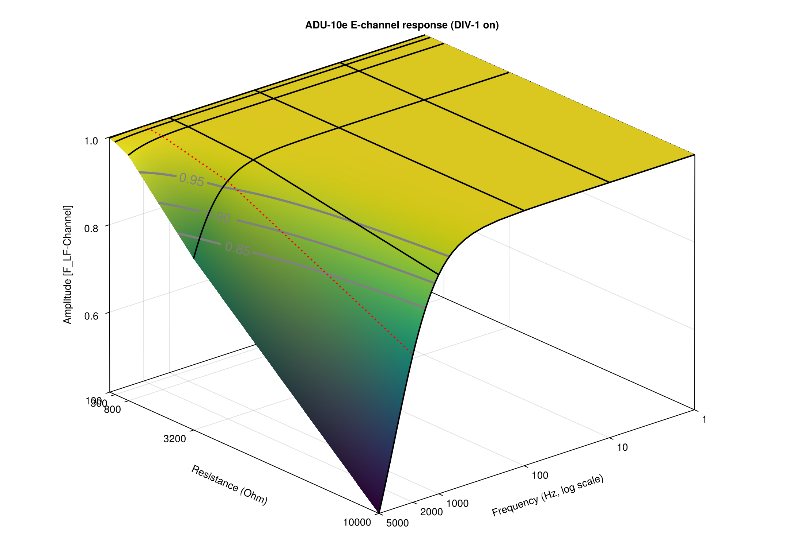
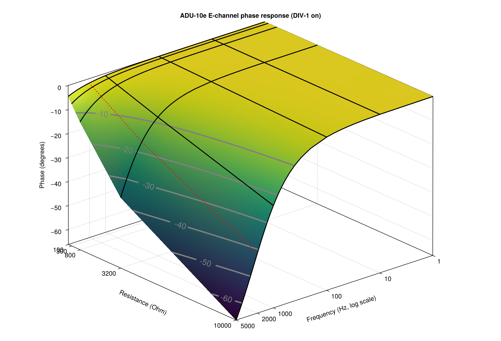
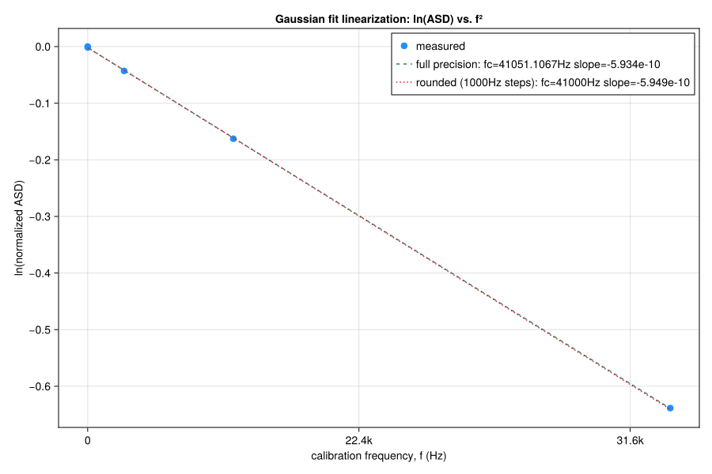

## ADU-08e

### HF Board 08e

The theoretical transfer function for the HF-channel is given below:

$F_{HF - Channel} = G_{1} \cdot F_{1} \cdot F_{2} \cdot F_{3} \cdot F_{4}$

with

$G_{1} = 1 \ or\  4, 8, 16$  depending on gain setting of first stage

$F_{1} = \frac{1}{1 + P_{1}}$; $P_{1} = i \cdot \frac{f}{338 kHz}$

$F_{2} = \frac{1}{1 + P_{2}}$; $P_{2} = i \cdot \frac{f \cdot G_{1} }{100 MHz}$

$F_{3} = \frac{1}{1 + P_{3}}$; $P_{3} = i \cdot \frac{f}{1.59 MHz}$

$F_{4} = \frac{P_{4}}{1 + P_{4}}$; $P_{4} = i\frac{f}{482 Hz}$
if high-pass is switched on.

$F_{4} = 1$
if high-pass is switched off.  

(gains and input divider are calibrated into the LSB, you don't see them)

### LF Board 08e

$F_{LF - Channel} = G_{1} \cdot G_{2} (\cdot G_{3})  \cdot F_{1} \cdot F_{2} \cdot F_{3} \cdot F_{4}$

$G_{1} = 1 \ or\ 4, 8, 16$ depending on gain stage 1 settings

$G_{2} = 1 \ or\  4, 8, 16, 32, 64$ depending on gain stage 2 settings, inside the ADC; (32, 64 not set by software, only manually)

Gains and input divider do not appear in the ats file, they are calibrated into the **LSB**

$G_{3} = 2$ is a fixed gain and can't be changed; this gain is *invisible* in the time series 

$F_{1} = \frac{1}{1 + P_{1}}$; $P_{1} = i\frac{f}{318 kHz}$

$F_{2} = \frac{1}{1 + P_{2}}$; $P_{2} = i\frac{f \cdot G_1 }{2 MHz}$

$F_{3} = \frac{1}{1 + 1.414 \cdot P_{3} + P_{3}^{2}}$; $P_{3} = i \cdot \frac{f}{4Hz}$
if 4 Hz Low-pass is switched on, else 1

and

$F_{4} = \frac{1}{1 + P_{4}}$;
$P_{4} = i \cdot \frac{f}{10.5 kHz}$ if **RF-2 on & DIV-8 = on** (default for **coil**, not used for E)

$F_{4} = \frac{1}{1 + P_{4}}$;
$P_{4} = i \cdot \frac{f}{30 kHz}$ if RF-1 on & DIV-8 = on (not used for E)

$F_{4} = \frac{1}{1 + P_{4}}$;
$P_{4} = i \cdot 2 \pi f \cdot (R_{sensor} + 200) \cdot 7.27E^{-9}Hz$
if **RF-2 on & DIV-1 = on** (default for electrodes **< 1500 Ohm** contact resistance, default for *buffer* electrodes, not used for H) )

$F_{4} = \frac{1}{1 + P_{4}}$;
$P_{4} = i \cdot 2 \pi f \cdot (R_{sensor} + 200) \cdot 470E^{-12}Hz$
if **RF-1 on & DIV-1 = on** ( electrodes **> 1500 Ohm** contact resistance, not used for H)

in old manuals the equations were written like 
$P_{4} = i \cdot \frac{f}{\frac{0.159}{(R_{sensor} + 200) \cdot 7.27E^{-9}Hz}}$  
$P_{4} = i \cdot \frac{f}{\frac{0.159}{(R_{sensor} + 200) \cdot 470E^{-12}Hz}}$  

## ADU-10e

### LF Board 10e

$F_{LF - Channel} = [G_{1}]  \cdot F_{1}   \cdot F_{4}$

$G_{1} = 1 \ or\ 4, 8, 16, 32, 64$  
The $G_{1}$ (inside ADC) is a chopper stabilized gain. The SW shall set 1 as default, for E this means $\pm$ 2.5 V input range. 
Since the gain $G_{1}$ and the input divider are inside the LSB (ATS format) or included in the mV data stream (ATSS) we neglect the gain.

$F_{1} = \frac{1}{1 + P_{1}}$; $P_{1} = i\frac{f}{318 kHz}$

and

$F_{4} = \frac{1}{1 + P_{4}}$;
$P_{4} = i \cdot \frac{f}{7.8 kHz}$ if **DIV-8 = on** (default for **coil**, not used for E)

$F_{4} = \frac{1}{1 + P_{4}}$;
$P_{4} = i \cdot 2 \pi f \cdot (R_{sensor} + 200) \cdot 6.8E^{-9}Hz$
if **DIV-1 = on** (default for electrodes, not used for H) )

(in old manuals the equation was written like $P_{4} = i \cdot \frac{f}{\frac{0.159}{(R_{sensor} + 200) \cdot 6.8E^{-9}Hz}}$ )

**red dotted line 2000 Hz** 
For H up to 2 kHz, the low-pass filter of the board can be considered negligible. The phase becomes almost not negligible.

For E the low-pass filter of the board has a more significant effect for higher frequencies and *high* resistance surfaces.

So at 5 k$\Omega$ and 2000 Hz in the spectra, the decay is 0.9.

## ADU-11e

To correct the low pass character of the ADU-11e[^adc_type], the following transfer functions are used:

### Board

$F_{LF - Channel} = [G_{2}]  \cdot F_{1} \cdot F_{2} = [G_{2}]  \cdot \frac{1}{1 + P_{1}} \cdot \frac{1}{1 + P_{2}}$

$G_{2} = 1 \ or\ 4, 8, 16, 32, 64$ (G1 was on old boards, not existing here,  G2 is inside ADC)  
Since the gain $G_{1}$ and the input divider are inside the LSB (ATS format) or included in the mV data stream (ATSS) we neglect the gain.

$F_{1} = \frac{1}{1 + P_{1}}$; $F_{2} = \frac{1}{1 + P_{2}}$

For **H** and **DIV-8 on**, always RF-1 (default for **coil**, not used for E)  
 $P_{1} = i \cdot 2 \pi f \cdot 2200 \cdot 1 \cdot E^{-9}$

 $P_{2} = i \cdot 2 \pi f \cdot 1100 \cdot 1 \cdot E^{-9}$

 For **E** and **DIV-1 on** (default for electrodes, not used for H)  

 - RF1 ("weak") $C=1.0 \cdot E^{-10}$ **< 1500 Ohm** contact resistance, default for *buffer* electrodes
 - RF2 ("strong") $C=1.1 \cdot E^{-9}$ &nbsp; **> 1500 Ohm** contact resistance

$P_{1} = i \cdot 2 \pi f \cdot (R_{sensor} + 2200) \cdot 1 \cdot E^{-9}$ 

$P_{2} = i \cdot 2 \pi f \cdot (\frac{R_{sensor}}{2} + 1100) \cdot C$ depending on RF1 or RF2 selection.

### ADC

Gaussian low-pass filter is applied to the signal:
$$e^{-\left(\frac{f}{f_c}\right)^{2}}$$

| sampling rate | cut-off frequency |
|---------------|-----------------|
| 1024 Hz       | 393 Hz          |
| 2048 Hz       | 786 Hz          |
| 4096 Hz       | 1570 Hz         |
| 8192 Hz       | 3140 Hz         |
| 16384 Hz      | 6261 Hz         |
| 32768 Hz      | 12370 Hz        |
| 65536 Hz      | 23600 Hz        |
| 131072 Hz     | 41000 Hz        |

In a plot natural logarithm of the normalized signal ln~normalized~ versus f² the 
Gaussian low-pass filter will appear as a straight line with a slope of $\frac{-1}{f_c²}.$

With fc = 0.38 * fsampling rate works perfectly up to 32 kHz and even 64 kHz. At 131 kHz the approximation starts to deviate significantly.

## ADU-07e

### HF Board 07e

The theoretical transfer function for the HF-channel is given below:

$F_{HF - Channel} = G_{1} \cdot G_{2} \cdot F_{1} \cdot F_{2} \cdot F_{3}$

with

$G_{1} = 1 \ or\ 8$  depending on gain setting of first stage

$G_{2} = 1 \ or\ 8 \ or\ 64$  depending on gain setting of second stage

$F_{1} = \frac{1}{1 + P_{1}}$; $P_{1} = i \cdot \frac{f}{7.23 MHz}$ if $G_1 \ne 1$

$F_{2} = \frac{1}{1 + P_{2}}$; $P_{2} = i \cdot \frac{f}{7.23 MHz}$ if $G_2 \ne 1$

$F_{3} = \frac{P_{3}}{1 + P_{3}}$; $P_{4} = i\frac{f}{1 Hz}$
if high-pass is switched on.

(gains and input divider are calibrated into the LSB, you don't see them)

### LF Board 07e

$F_{LF - Channel} = G_{1} \cdot G_{2} \cdot F_{1} \cdot F_{2} \cdot F_{3} \cdot F_{4}$

$G_{1} = 1 \ or\ 2, 4, 8, 16, 32, 64$ depending on gain stage 1 settings

$G_{2} = 1 \ or\ 2, 4, 8, 16, 32, 64$ depending on gain stage 2 settings, inside the ADC; (32, 64 not set by software, only manually)

$F_{1} = \frac{1}{1 + P_{1}}$; $P_{1} = i \cdot \frac{f}{4 kHz}$  **// to be checked** if $G_1 \ne 1$

$F_{2} = \frac{1}{1 + P_{2}}$; $P_{2} = i \cdot \frac{f}{21.2 kHz}$  **// to be checked** 

$F_{3} = \frac{1}{1 + 1.414 \cdot P_{3} + P_{3}^{2}}$; $P_{3} = i \cdot \frac{f}{4Hz}$
if 4 Hz Low-pass is switched on

$F_{4} = \frac{1}{1 + P_{4}}$;
$P_{4} = i \cdot 2 \pi f \cdot (R_{sensor} + 200) \cdot 2.2E^{-11}Hz$
if **RF-1 on & DIV-1 = on** (default for electrodes **< 600 Ohm** contact resistance not used for H, prefer RF-2) )

$F_{4} = \frac{1}{1 + P_{4}}$;
$P_{4} = i \cdot 2 \pi f \cdot (R_{sensor} + 200) \cdot 1.22E^{-10}Hz$
if **RF-2 on & DIV-1 = on** (default for electrodes **< 1500 Ohm** contact resistance, default for *buffer* electrodes, not used for H) )

$F_{4} = \frac{1}{1 + P_{4}}$;
$P_{4} = i \cdot 2 \pi f \cdot (R_{sensor} + 200) \cdot 6.822E^{-9}Hz$
if **RF-3 on & DIV-1 = on** (default for electrodes **1500-2500 Ohm** contact resistance, prefer RF-4 not used for H) )

$F_{4} = \frac{1}{1 + P_{4}}$;
$P_{4} = i \cdot 2 \pi f \cdot (R_{sensor} + 200) \cdot 6.922E^{-9}Hz$
if **RF-4 on & DIV-1 = on** (default for electrodes **> 1500 Ohm** contact resistance) )

**// missing DIV-8**

### MF Board 07e

tbd.

## MFS Coils

<b>OLD Calibration Files are normalized by f!</b>   
e.g. the MFSXXX.txt files.  
The JSON files are using mV (as the time series data) and are not normalized by f.  
If you normalize the calibration you end up with a *constant* $\frac{200  mV}{nT \cdot Hz}$ and 90° 
phase below 0.1 Hz for the MFS-06e and $\frac{20  mV}{nT \cdot Hz}$ and 90° for the MFS-07e.  

The term $P_{1}$ is the cut-off frequency generated by the feedback coil.  
The other terms $P_{2}$, $P_{3}$, $P_{4}$ are result of the pre-amplifier components[^about_p4][^coil_rev].  

### MFS-06e
$P_{1} = i \cdot \frac{1}{4 Hz}, \enspace P_{2} = i \cdot \frac{1}{9645 Hz} \enspace$
$P_{3} = i \cdot \frac{1}{0.72 Hz},\enspace P_{4} = i \cdot \frac{1}{23897 Hz}$

#### Chopper on
$F_{on}(f)\,\left[\frac{mV}{nT}\right] = 800 \cdot \frac{P_1}{1+P_1} \cdot \frac{1}{1+P_2} \cdot \frac{1}{1+P_4}$

#### Chopper off
$F_{off}(f)\,\left[\frac{mV}{nT}\right] = 800 \cdot \frac{P_1}{1+P_1} \cdot \frac{1}{1+P_2} \cdot \frac{P_3}{1+P_3} \cdot \frac{1}{1+P_4}$

### MFS-07e

$P_{1} = i \cdot \frac{1}{32 Hz}, \enspace P_{2} = i \cdot \frac{1}{45150 Hz} \enspace$

$P_{3} = i \cdot \frac{1}{0.72 Hz},\enspace P_{4} = i \cdot \frac{1}{49735 Hz}$

#### Chopper on

$F_{on}(f)\,\left[\frac{mV}{nT}\right] = 640 \cdot \frac{P_1}{1+P_1} \cdot \frac{1}{1+P_2} \cdot \frac{1}{1+P_4}$

#### Chopper off

$F_{off}(f)\,\left[\frac{mV}{nT}\right] = 640 \cdot \frac{P_1}{1+P_1} \cdot \frac{1}{1+P_2} \cdot \frac{P_3}{1+P_3} \cdot \frac{1}{1+P_4}$

### MFS-12e

$P_{1} = i \cdot \frac{1}{16 Hz}, \enspace P_{2} = i \cdot \frac{1}{9645 Hz} \enspace$
$\enspace P_{4} = i \cdot \frac{1}{50048 Hz}$

#### Switch free
In the old days we used copper on == LF mode and chopper off == HF mode. 
Now we have a switch free design, so only one transfer function is used. 
However, the amplifier still has a chopper stage, which is always on, but invisible in the transfer function.  
The transfer function is a mix of both modes: 
$F(f)\,\left[\frac{mV}{nT}\right] = 800 \cdot \frac{P_1}{1+P_1} \cdot \frac{1}{1+P_2} \cdot \frac{1}{1+P_4}$

### MFS-14e

tdb.

## SHFT coils

### SHFT-02e

Only a basic approximation of the transfer function is available:

$P_{1} = i \cdot \frac{f}{300,000 Hz}$

$F(f)\,\left[\frac{mV}{nT}\right] = 50 \cdot \frac{1}{1 + P_1}$

**YOU MUST USE THE CALIBRATION FILES FOR THIS SENSOR**

### SHFT-03e

**YOU MUST USE THE CALIBRATION FILES FOR THIS SENSOR**

## Fluxgates

Fluxgate magnetometers from Bartington Instruments just need to be scaled.

### FGS-02e
Fluxgate with 75,000 nT range, Geomag-01.

$F(f)\,\left[\frac{mV}{nT}\right] = 7.5 \cdot 10^{-4}$

### FGS-03e
Fluxgate with 100,000 nT range, Bartington Mag-03.

$F(f)\,\left[\frac{mV}{nT}\right] = 1 \cdot 10^{-4}$

### FGS-04e
Fluxgate with 100,000 nT range, Bartington Mag-13 MCL (MC = cylindrical core, L = low noise).  
That is a newer version of the FGS-03e, with a better noise performance.  

$F(f)\,\left[\frac{mV}{nT}\right] = 1 \cdot 10^{-4}$

### FGS-05e
Fluxgate with 75,000 nT range, Bartington (never sold) 
You may get an out of drift here.

$F(f)\,\left[\frac{mV}{nT}\right] = 1.43 \cdot 10^{-4}$

[^about_p4]: $P_{4}$ is tuned during calibration; so 23897 (for MFS-06e) is not fixed; however $P_{4}$  
has almost no influence in the calculation of the transfer function.

[^coil_rev]: MFS-6e :Rev. 1p4, MFS-7e :Rev. 1.2

[^adc_type]:  Analog Devices AD7771 mit SINC5
